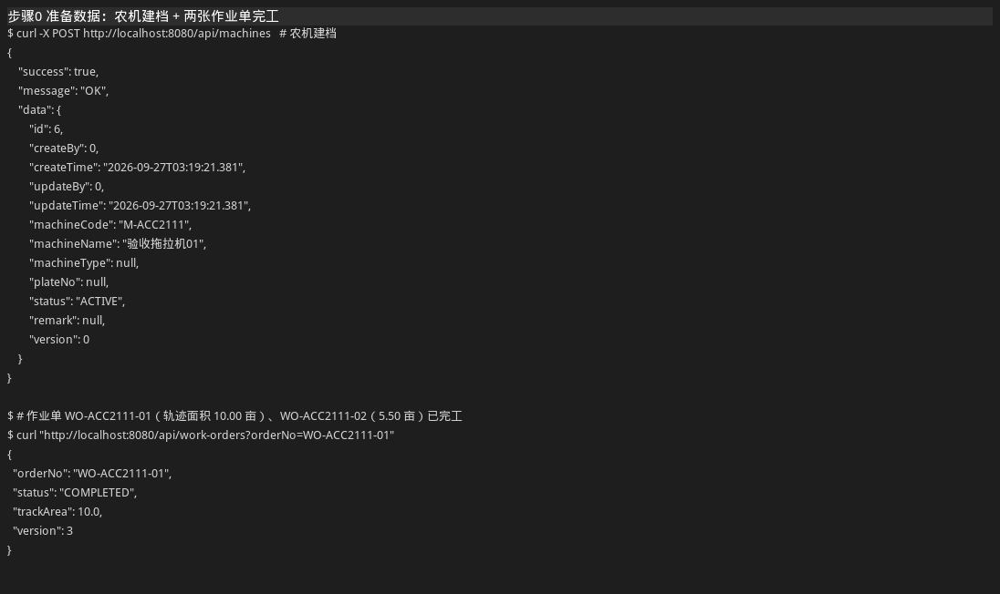
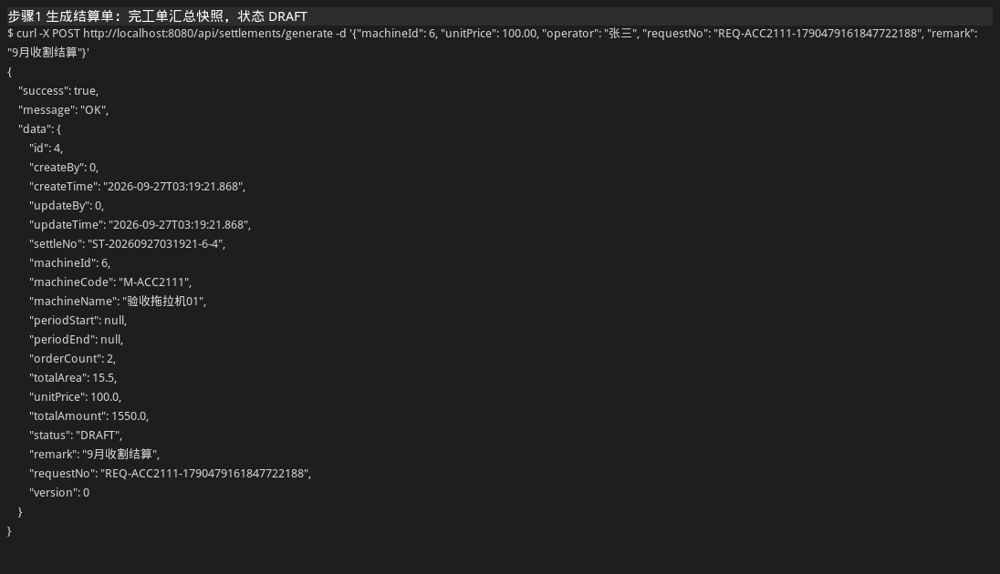
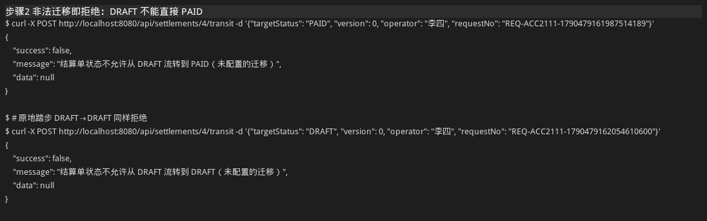
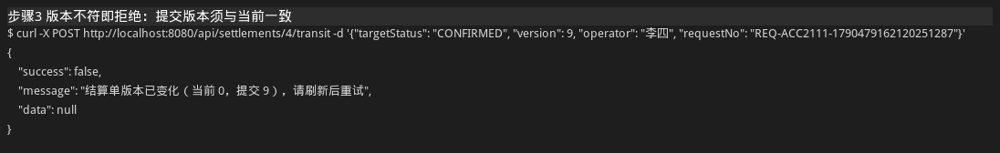
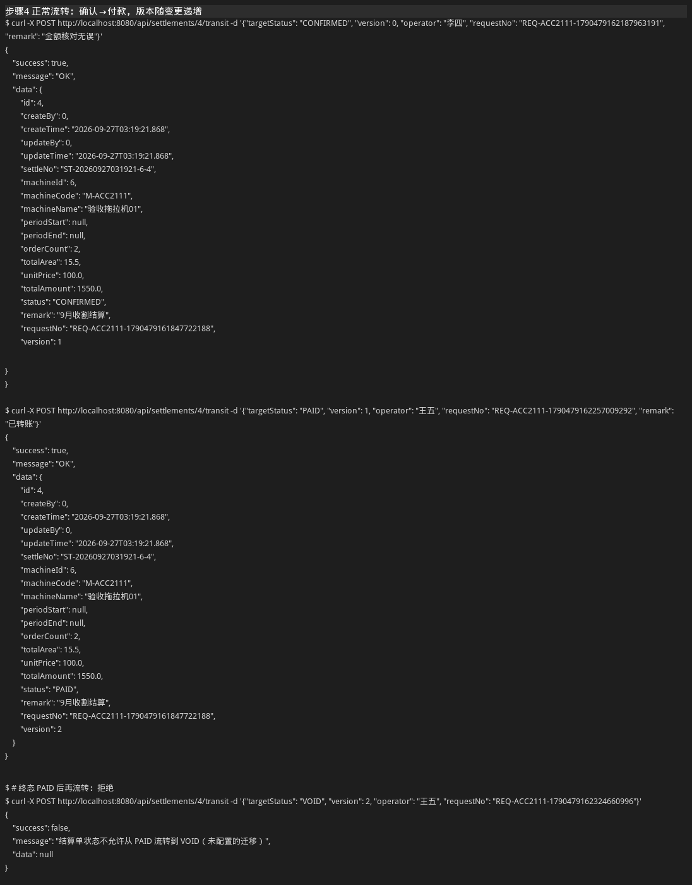
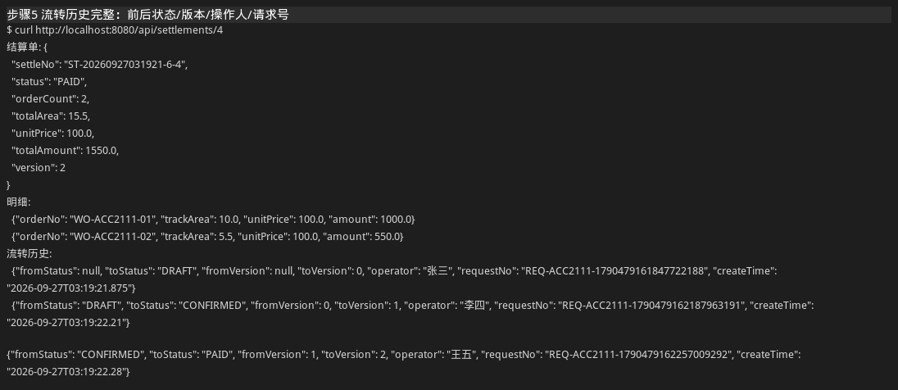
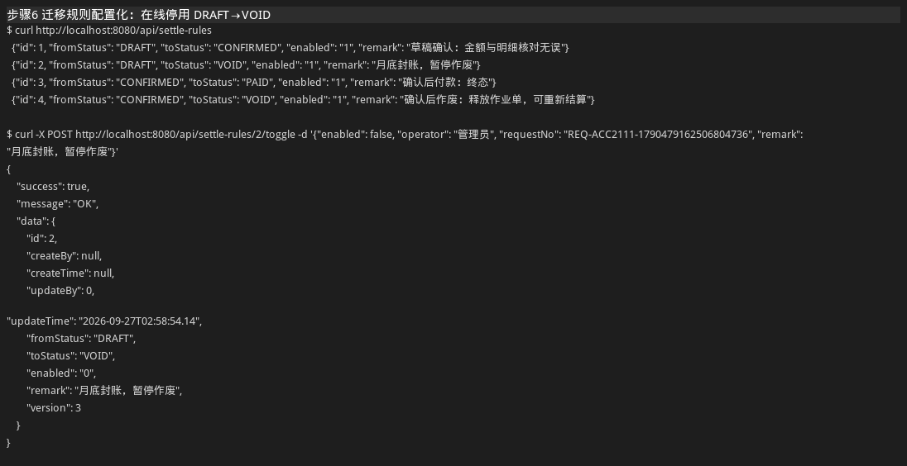
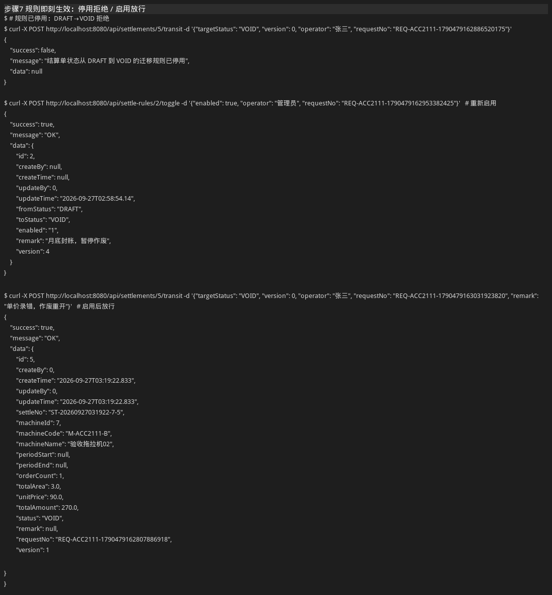
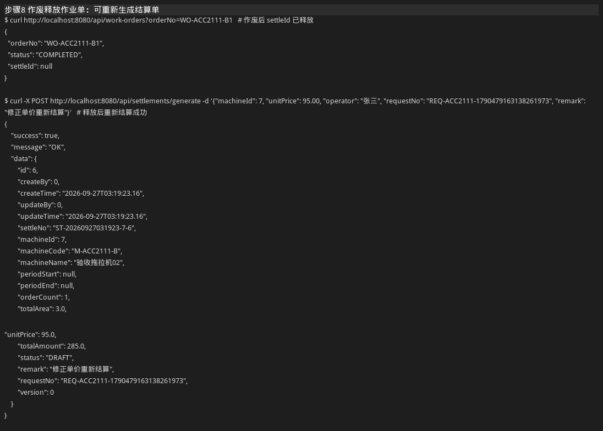

# F4 结算单状态机 验收报告

> 面向未参加评审会的同事：按「背景 → 规则 → 步骤实录（截图）→ 结论」顺序阅读即可，
> 所有截图均为对运行中服务真实调用的实录，可按要求复现。

## 1. 背景：要解决什么问题

- 结算一直靠导出作业单后**线下二次加工**（Excel 算面积、算钱），既慢又容易错；
- 结算状态**没有约束**，口头/表格流转，状态乱跳导致数据错乱，出了问题查不到是谁、什么时候改的。

本次在结算单上落地：

| 要求 | 实现 |
| --- | --- |
| 数据不再二次加工 | 结算单从系统内**已完工、未红冲、未被占用**的作业单一键生成，金额 = 轨迹核算面积 × 单价逐单快照 |
| 上状态机 | `DRAFT → CONFIRMED → PAID`，`DRAFT/CONFIRMED → VOID`，`PAID`/`VOID` 为终态 |
| 迁移规则配置化 | 规则落库 `t_settle_transition_rule`，接口在线启停、实时生效、重启不丢 |
| 入口统一校验 | 所有状态变更只走 `POST /api/settlements/{id}/transit`，先校验版本、再校验状态机规则 |
| 非法迁移即拒绝 | 未配置/已停用的迁移直接返回 `success=false` 并说明原因 |
| 每次变更带版本与操作人 | 请求必带 `version`（与当前一致才放行，落库自动 +1）和 `operator`（必填） |
| 流转历史完整 | `t_settle_status_log` 只追加不修改，记录前后状态、前后版本、操作人、请求号、时间 |

## 2. 验收环境

- 服务：`mvn spring-boot:run` 本地启动（`http://localhost:8080`，dev 库 `data/evops`）；
- 日期：2026-09-27；代码：工作区当前版本（F4，`schema.sql` 已登记 `f4-settlement`）；
- 自动化测试：`mvn test` 54 个用例全部通过（其中结算新增 10 个：主链路 7 + 接口 3）；
- 验收脚本：`docs/acceptance/run-acceptance.sh`（可重跑，每次生成全新数据，不影响已有单据）。

## 3. 迁移规则（配置化，种子 4 条）

| 起始状态 | 目标状态 | 含义 |
| --- | --- | --- |
| DRAFT | CONFIRMED | 草稿确认：金额与明细核对无误 |
| DRAFT | VOID | 草稿作废：释放作业单，可重新结算 |
| CONFIRMED | PAID | 确认后付款：终态 |
| CONFIRMED | VOID | 确认后作废：释放作业单，可重新结算 |

其余组合（如 DRAFT→PAID 跳状态、终态再流转、原地踏步）一律拒绝。规则可在线启停（步骤 6、7）。

## 4. 验收步骤实录

### 步骤 0　准备数据：农机建档 + 两张作业单完工



作业单 `WO-ACC2111-01`（轨迹面积 10.00 亩）、`WO-ACC2111-02`（5.50 亩）已登记权威轨迹面积并完工。

### 步骤 1　生成结算单：完工单汇总快照，状态 DRAFT



**看点**：一单生成，明细逐单快照（10.00×100=1000.00、5.50×100=550.00），合计面积 15.50 亩、
金额 1550.00 元，初始状态 `DRAFT`、版本 0。下游直接可用，不再需要二次加工。

### 步骤 2　非法迁移即拒绝：DRAFT 不能直接 PAID



**看点**：草稿直接付款 → `结算单状态不允许从 DRAFT 流转到 PAID（未配置的迁移）`；
原地踏步 DRAFT→DRAFT 同样拒绝。状态不再乱跳。

### 步骤 3　版本不符即拒绝：提交版本须与当前一致



**看点**：当前版本是 0，拿版本 9 提交 → 拒绝并提示当前版本，防止基于过期页面误改。

### 步骤 4　正常流转：确认 → 付款，版本随变更递增



**看点**：`DRAFT→CONFIRMED`（操作人李四，版本 0→1）、`CONFIRMED→PAID`（操作人王五，版本 1→2）
均放行；终态 `PAID` 后再流转 → 拒绝。

### 步骤 5　流转历史完整：前后状态/版本/操作人/请求号



**看点**：`GET /api/settlements/{id}` 一次拿回结算单 + 明细 + 三条流转日志
（生成→确认→付款），每条都带前后状态、前后版本、操作人、请求号、时间，只追加不修改。

### 步骤 6　迁移规则配置化：在线停用 DRAFT→VOID



**看点**：`GET /api/settle-rules` 列出全部规则；`POST /api/settle-rules/2/toggle`
停用「草稿作废」（enabled 置 0），规则行自身也带乐观锁版本。

### 步骤 7　规则即刻生效：停用拒绝 / 启用放行



**看点**：停用期间作废 → `迁移规则已停用`；重新启用后同一请求放行。
调规则不用改代码、不用重启。

### 步骤 8　作废释放作业单：可重新生成结算单



**看点**：作废后作业单 `settleId` 释放（置空），同一批完工单可按修正后单价重新结算；
未作废前重复生成会被拒（`没有可结算的完工作业单`），防止一单多结。

## 5. 验收结论

| 验收项 | 结果 | 证据 |
| --- | --- | --- |
| 结算数据不再二次加工 | 通过 | 步骤 1：完工单 → 结算单一键生成、金额快照 |
| 状态机落地 | 通过 | 步骤 4：DRAFT→CONFIRMED→PAID 全链路 |
| 非法迁移即拒绝 | 通过 | 步骤 2：跳状态/原地踏步拒绝；步骤 4：终态再流转拒绝 |
| 迁移规则配置化 | 通过 | 步骤 6、7：在线停用即拒、启用即放行 |
| 每次变更带版本与操作人 | 通过 | 步骤 3：版本不符拒绝；步骤 4、5：版本递增、操作人留痕 |
| 流转历史完整 | 通过 | 步骤 5：三条日志完整，前后状态/版本/操作人/请求号齐全 |
| 自动化测试 | 通过 | `mvn test` 54/54 绿（结算新增 10 例覆盖上述全部场景） |

## 6. 复现方法

```bash
mvn spring-boot:run                 # 启动服务（:8080）
docs/acceptance/run-acceptance.sh   # 逐步执行验收并重新生成截图到 docs/acceptance/
mvn test                            # 全量自动化用例
```

接口口径见 [README](../README.md)「F4 结算单状态机」一节。
